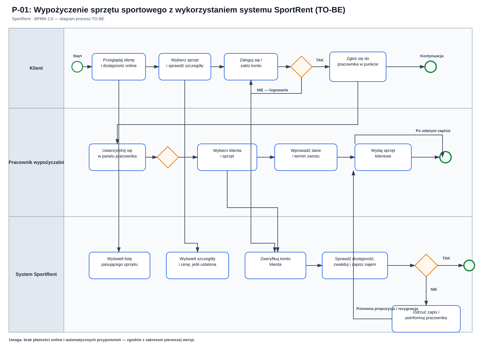

# P-01: Wypożyczenie sprzętu sportowego (TO-BE)

**Wersja:** 0.2 · **Właściciel:** @NzDDD;@Bohdan52;Andrusha0500;@rostik88afk · **Powiązane:** P-00 (AS-IS), P-02

## Cel procesu
Umożliwienie klientowi samodzielnego sprawdzenia oferty i dostępności sprzętu online oraz sprawna rejestracja wypożyczenia przez pracownika w systemie SportRent.

## Wyzwalacz (zdarzenie początkowe)
Klient chce wypożyczyć sprzęt lub odzież sportową.

## Uczestnicy (tory i pule)
- **Pula: SportRent** (tory: *Klient*, *Pracownik wypożyczalni*, *System SportRent*)

## Wyniki (zdarzenia końcowe)
- Sprzęt wydany i wypożyczenie zarejestrowane (sukces)
- Rezygnacja klienta (brak odpowiedniego sprzętu lub ceny)
- Odmowa wypożyczenia (błędne dane lub brak uprawnień)

## Diagram

Źródło: [P-01-wypozyczenie-sprzetu.bpmn](P-01-wypozyczenie-sprzetu.bpmn) (wykonano w bpmn.io)

## Kroki procesu

| Krok | Tor | Typ zadania | Opis | Wymagania |
|---|---|---|---|---|
| P-01.1 | Klient | użytkownika | Przeglądaj listę dostępnego sprzętu lub wyszukaj po nazwie | FR-01, FR-02 |
| P-01.2 | System SportRent | usługi | Wyświetl listę pasującego sprzętu | FR-01, FR-02 |
| P-01.3 | Klient | użytkownika | Wybierz sprzęt i sprawdź szczegóły oraz cenę wypożyczenia | FR-03, FR-04 |
| P-01.4 | System SportRent | usługi | Wyświetl szczegóły sprzętu i cenę (jeśli określona) | FR-03, FR-04 |
| P-01.5 | Klient | użytkownika | Zgłoś się do pracownika w punkcie w celu wypożyczenia | — (poza systemem) |
| P-01.6 | Pracownik | użytkownika | Uwierzytelnij się w panelu pracownika i wybierz rejestrację wypożyczenia | NFR-03, FR-08 |
| P-01.7 | Pracownik | użytkownika | Wprowadź dane wypożyczenia, datę rozpoczęcia oraz planowany termin zwrotu | FR-08, FR-09, FR-10 |
| P-01.8 | System SportRent | usługi | Zwaliduj dane, zapisz wypożyczenie i zmień status sprzętu na niedostępny | NFR-05, FR-07, FR-08 |
| P-01.9 | Pracownik | ręczne | Wydaj sprzęt klientowi | — (poza systemem) |

## Wyjątki i ścieżki alternatywne

| Wyjątek | Gdzie w procesie | Reakcja systemu / procesu | Wymaganie / NFR |
|---|---|---|---|
| Brak szukanego sprzętu na liście dostępnych | Po P-01.2 (bramka XOR) | Klient zmienia kryteria wyszukiwania lub rezygnuje | FR-01, FR-02 |
| Brak uprawnień do funkcji pracownika | Krok P-01.6 | System blokuje dostęp do formularza rejestracji wypożyczenia | NFR-03 |
| Niepoprawne lub niekompletne dane (np. błędna data zwrotu) | Krok P-01.8 (bramka XOR) | System odrzuca zapis i wyświetla komunikat błędu walidacji | NFR-05 |

## Zmiany względem AS-IS
- **Samoobsługa informacyjna:** klient sam sprawdza dostępność, szczegóły i ceny online przed wizytą (`FR-01`–`FR-04`), bez dzwonienia i czekania.
- **Automatyzacja ewidencji:** pracownik rejestruje wypożyczenie w systemie zamiast w zeszycie/Excelu (`FR-08`–`FR-10`), a status dostępności sprzętu aktualizuje się automatycznie (`FR-07`).
