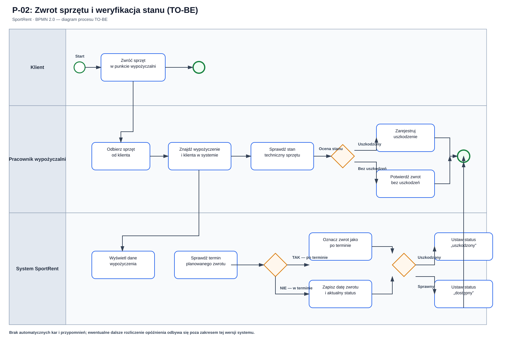

# P-02: Zwrot sprzętu i weryfikacja stanu (TO-BE)

**Wersja:** 0.2 · **Właściciel:** @NzDDD;@Bohdan52;Andrusha0500;@rostik88afk · **Powiązane:** P-01

## Cel procesu
Rejestracja zwrotu wypożyczonego sprzętu, kontrola terminowości i stanu technicznego oraz przywrócenie dostępności sprzętu w katalogu.

## Wyzwalacz (zdarzenie początkowe)
Klient przynosi wypożyczony sprzęt do punktu zwrotu.

## Uczestnicy (tory i pule)
- **Pula: SportRent** (tory: *Klient*, *Pracownik wypożyczalni*, *System SportRent*)

## Wyniki (zdarzenia końcowe)
- Zwrot zarejestrowany, sprzęt ponownie dostępny (sukces)
- Zwrot zarejestrowany z opisem uszkodzenia, sprzęt wycofany/niedostępny

## Diagram

Źródło: [P-02-zwrot-sprzetu.bpmn](P-02-zwrot-sprzetu.bpmn) (wykonano w bpmn.io)

## Kroki procesu

| Krok | Tor | Typ zadania | Opis | Wymagania |
|---|---|---|---|---|
| P-02.1 | Klient | ręczne | Przekaż wypożyczony sprzęt pracownikowi | — (poza systemem) |
| P-02.2 | Pracownik | użytkownika | Wyszukaj aktywne wypożyczenie w systemie | FR-15 |
| P-02.3 | Pracownik | ręczne | Sprawdź stan techniczny i czystość sprzętu | — (poza systemem) |
| P-02.4 | Pracownik | użytkownika | Zapisz informację o uszkodzeniu (jeśli wykryto) | FR-13 |
| P-02.5 | Pracownik | użytkownika | Zarejestruj zwrot sprzętu w systemie | FR-11 |
| P-02.6 | System SportRent | usługi | Zapisz zwrot w historii i zaktualizuj dostępność/status sprzętu | FR-11, FR-12, FR-07, FR-14 |

## Wyjątki i ścieżki alternatywne

| Wyjątek | Gdzie w procesie | Reakcja systemu / procesu | Wymaganie |
|---|---|---|---|
| Sprzęt jest uszkodzony | Po P-02.3 (bramka XOR) | Pracownik zapisuje opis uszkodzenia (`FR-13`) i ustawia status sprzętu na niedostępny/serwis (`FR-07`) zamiast udostępniać go klientom | FR-13, FR-07 |
| Przekroczony planowany termin zwrotu | Krok P-02.2 / P-02.5 | System wykazuje opóźnienie na podstawie zapisanego planowanego terminu zwrotu (`FR-10`) | FR-10, FR-15 |
